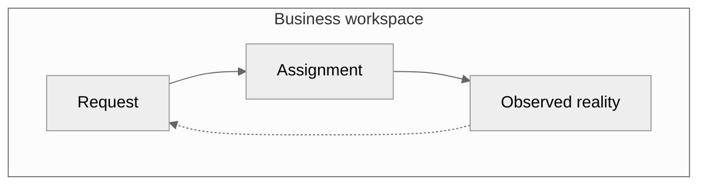
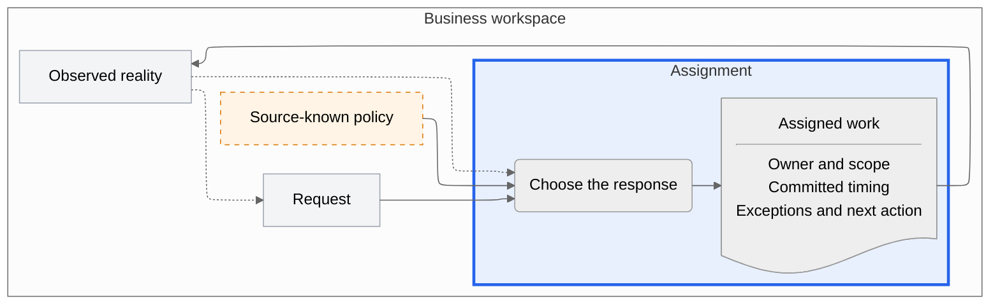

# Mermaid patterns

Use these patterns when the user asks for Mermaid. They follow the same rules as the PlantUML patterns; only the notation changes. Replace placeholders with source-derived names and remove unsupported elements and loops.

Start every diagram with this config so that lines stay curved, boxes have no shadows, and labels are not wrapped narrowly. L2 uses `layout: elk` instead, as in its example:

```yaml
---
config:
  theme: neutral
  layout: dagre  # elk: lines never pass behind boxes, but are right-angled
  look: classic
  flowchart:
    wrappingWidth: 420
---
```

| PlantUML | Mermaid |
| --- | --- |
| frame `rectangle` | `systemBoundary` in the people map, `subgraph` elsewhere |
| boundary object `rectangle` | `Id["..."]` |
| `actor` | `actor` (people map only) |
| `component` | a rectangle outside the boundary (people map only) |
| `process` | `Id("...")` |
| `artifact` | `Id@{ shape: doc, label: "..." }` |
| `skinparam` palette section | `classDef` and `style` lines between `%% BEGIN COLOR PALETTE` and `%% END COLOR PALETTE` |

## L1

Draw two diagrams with the same frame and the same objects. Give each object a stable name.

### People map

Use a use case diagram. Its labels accept no HTML: write the name in bold and the synopsis on the next physical line inside a Markdown string.

```mermaid
---
config:
  theme: neutral
  layout: dagre  # elk: lines never pass behind boxes, but are right-angled
  look: classic
  flowchart:
    wrappingWidth: 420
---
usecase-beta
  direction LR
  actor RoleA("Role A")
  actor RoleB("Role B")

  systemBoundary "Business workspace"
    Request["`**Request**
Scope / timing / priority`"]
    Assignment["`**Assignment**
Owner / timing / exceptions`"]
    Observation["`**Observed reality**
Completion / blockers / remaining work`"]
  end

  RoleA -- Request
  RoleB -- Assignment
  RoleB -- Observation
```

### Flow map



## L2

Mermaid comments are line comments only, so the palette section is disabled by commenting out each line between its markers.



## Constraints

- Default to `layout: dagre` for L1 and `layout: elk` for L2, and keep the comment on that line, so readers can switch the layout themselves.
- In every flowchart, write `direction LR` inside the frame `subgraph`. Without it, the frame's contents are drawn top to bottom.
- Use dashed arrows `-.->` for feedback and `--` for involvement in the people map.
- Keep the thick focus border and dashed input border outside the palette section, and repeat them inside it, so they remain when the palette is commented out.
