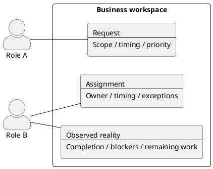
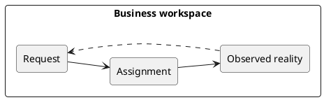
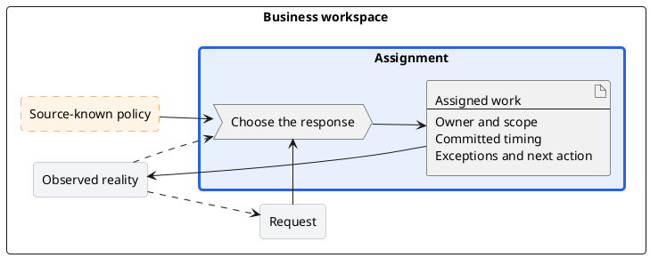

# PlantUML patterns

Use these patterns as notation constraints, not as a domain model. Replace placeholders with source-derived names and remove unsupported elements and loops.

## L1

Draw two diagrams with the same frame and the same objects. Give each object a stable name.

### People map

Show who and what is involved with each object. Give each object a short content synopsis. Add actors and, only where the source names them and divides responsibility among them, functional systems around the frame. A system is not a replacement for a boundary object or a mandatory intermediary between objects.

### Flow map

Show how the objects follow the source's overall flow, and the feedback the source states. Use names only, without actors or systems.

Object-to-object arrows describe coordination and consequences, not information executing itself.

## L2

Keep context labels compact: use stable names without their L1 synopses unless a qualifier is needed. `artifact` denotes this information result, not the focused L1 container or every source input.

Keep custom colors in the palette section only. That section can be disabled with PlantUML block-comment delimiters (`/'` and `'/`) without changing border thickness or line style.

## Constraints

- Use `rectangle` for boundary objects and inputs, `actor` for human roles or organizations, and `component` for a needed functional system. A component does not prescribe software deployment units.
- Adding System does not change the criteria for selecting boundary objects. Do not replace the object-level main path with an inventory of components and artifacts.
- Use `process` only inside the focused rectangle, and `artifact` for its information result.
- Preserve stable names and kinds of L1-derived elements, not the full decorated label. The people map shows name plus synopsis; the flow map and L2 context show name only. Only boundary objects require one L2 each.
- Use undirected involvement lines for actors and systems by default. Do not require an executor node between every pair of boundary objects.
- Keep dashed arrows for feedback consistently across levels. A dashed input rectangle means source-known input omitted from L1, not a new question or a feedback relation.
- When an L2 includes feedback, retain the object-level forward path that produces its source and its return destination. This does not require copying every participant from L1.
- Do not put explanatory prose on relationships. Do not add methodology sections or repeat explanations already present in the source.
- Put all custom colors in a single optional `skinparam` palette section per diagram. No inline element or arrow colors, colored legend cells, or color markup in labels. Keep thickness, dashed borders, and other non-color settings outside the palette. Elements without a working `skinparam` color setting use neutral defaults.
- Keep hidden styling stereotypes. Do not require visible focus/source-input markers or a separate `monochrome` switch.
- Inspect the initiating demand, object-level main path and feedback, readable focus, crossings, and width. If systems obscure the main path, remove unnecessary system context rather than reducing boundary objects to fit it.
